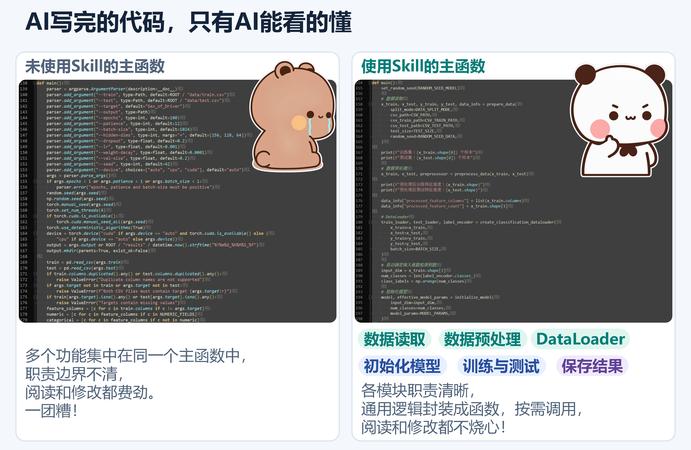
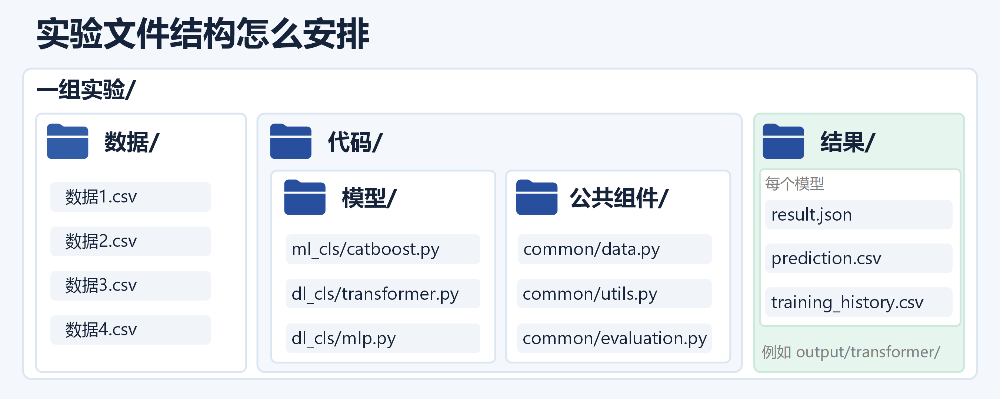

# ML/DL Code Skill 

**代码是 AI 写的，接手的人也该看得懂。**

ML/DL Code Skill · `v0.5.1`

这是一套面向机器学习和深度学习表格分类实验的 Skill。它为 AI 提供代码模板和实验规范，让生成的代码参数集中、模型独立、结果按统一格式保存。换数据集时知道改哪项配置，调整模型时知道进哪个文件，重跑实验后也方便对比结果。

## 主函数，别开杂货铺

AI 写的实验代码能跑，可一出问题，读取数据、预处理和训练逻辑全挤在一起，连从哪儿查都不知道。最后只能回到对话框，让 AI 查自己写的代码。它改了哪里、改得对不对，自己心里也没底。

用这套 Skill 写实验代码，读取数据、预处理、训练、评价和保存都有各自的入口。顺着主函数就能看清整个流程，想排查或修改哪一步，打开对应的函数就行。



## 文件各回各家，找起来不抓瞎

数据、代码、结果分开放；模型保留自己的实验流程，公共逻辑放进 `common/`。下周再打开，也少问一句：“这真是我上周跑的？”



## 能干点什么？

- **跑分类**：CSV 二分类、多分类，随机划分、固定划分和 K-Fold。
- **比模型**：支持 CatBoost、XGBoost、MLP 等，统一指标与结果格式。
- **做检查**：训练前查代码，训练后查输出，给实验收个尾。

## 开始使用

把完整文件夹放到 Agent 能读取的位置，告诉它：

```text
请读取 ./human_code_skill/SKILL.md，使用这套 Skill，
对 ./data.csv 训练 CatBoost，最后一列为标签，分层 8:2 划分。
```

把路径换成你自己的，就可以开始。愿你下次改实验，少一点深呼吸。

[查看 Skill 说明](SKILL.md) · [查看模型代码](scripts/ml_cls/catboost.py) · [查看五折案例](assets/exp3_5-fold/README.md)
